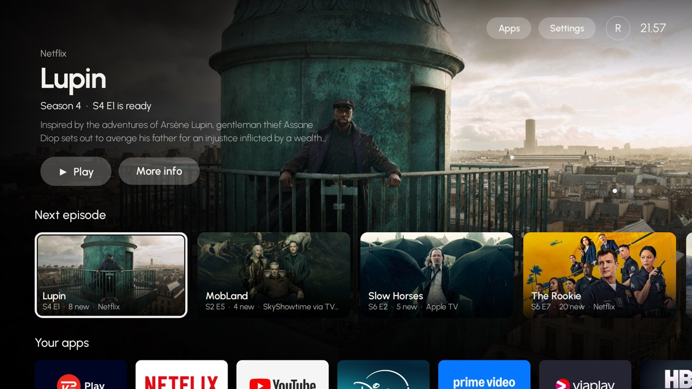
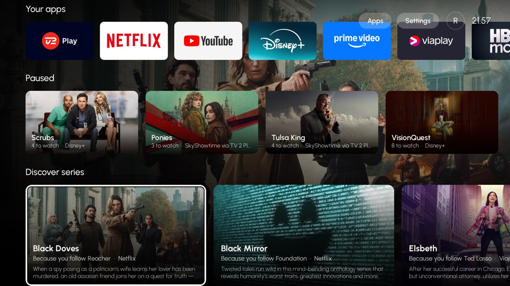
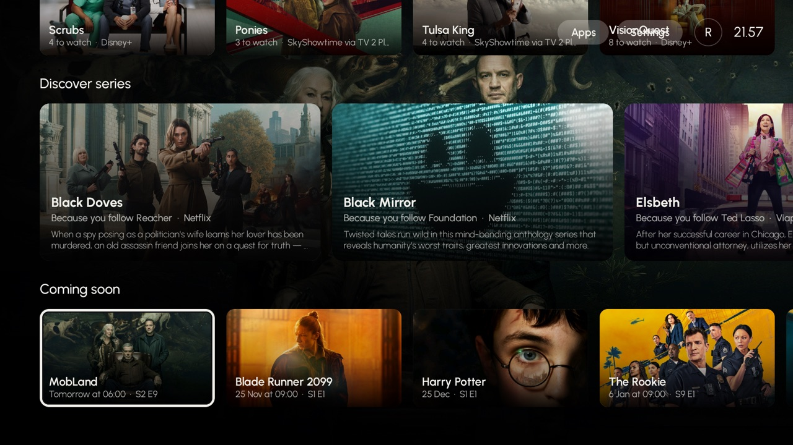

*English · [Dansk](README.da.md)*

# SeasonPass TV

A home screen for Android TV that shows your shows: a big show on top, **Next episode**, **Your apps**, **Paused**, **Discover series**
and **Coming soon**. It also has a screensaver with a slideshow of your shows, a big clock and what is playing in Spotify.

> **Requires the SeasonPass app on your phone.** SeasonPass TV is only one half: the phone app knows your shows and sends them
> to the TV over Wi-Fi. The SeasonPass app is a separate project and not part of this repo. Without it the TV only shows your apps and an empty list of shows.
>
> **Don't want SeasonPass?** Switch on **Settings → Use without SeasonPass**: the home screen then shows only today's date and your apps, the screensaver only the clock, and the TV does not listen for a phone at all.



| | |
|---|---|
|  |  |
| Scroll down: **Your apps**, **Paused** and **Discover series**. | **Discover series** and **Coming soon**. |


The screenshots show the English version. The TV follows the language of the SeasonPass app on your phone (eight languages).

## What it does

- Shows the next episode of your shows and works out by itself when a new episode is out, even when your phone is off.
- **Discover series** with suggestions based on what you watch, and the buttons *Seen it* and *Not for me*, which the phone picks up and acts on.
- **Screensaver** with your shows as a slideshow (circle transition with a soft edge and a slow zoom), a big clock and a small box with what is playing in the Spotify app on the TV.
- **Settings** on the TV: screensaver content, clock, music and updates. The avatar shows the first letter of your name from the phone. Choose which of your apps appear on the home screen (hold OK on an app).
- Without a phone: the app speaks the TV's own language (English, Danish, Swedish, Norwegian, Finnish, Icelandic, Faroese or Greenlandic), and **Use without SeasonPass** gives a clean home screen with just your apps and a clock.
- Tells you when there is a new version and can update itself (downloaded from GitHub, with a checksum).
- Can be made the TV's home screen and undone again. Small: about 150 KB, no dependencies.
- The install scripts speak eight languages (English, Danish, Swedish, Norwegian, Finnish, Icelandic, Faroese, Greenlandic), chosen from your computer's language or with `--lang`.

## What you need

1. An **Android TV** (Android 8 or newer).
2. The **SeasonPass app** on your phone.
3. A **computer** for the install, once (Mac, Linux, or Windows with Git Bash/WSL). It takes about 10 minutes.

## Install

Download `SeasonPass-TV.apk`, `install.sh`, `lib.sh` and `undo-home.sh` from the [latest release](https://github.com/ryanlumbye-rl/seasonpass-tv/releases/latest)
and put them in the same folder. Turn on USB debugging on the TV, run `./install.sh <tv-ip>`, and pair with your phone.
Step by step: **[INSTALL.md](INSTALL.md)**.

## License and credits

MIT, see [LICENSE](LICENSE). Third parties and credits (Urbanist, TMDB, TVmaze): [THIRD_PARTY.md](THIRD_PARTY.md).

---

## For developers (you can skip this)

This is only for you if you want to change the code and make your own APK. If you just want to use the app, you are done above.

```bash
./gradlew assembleRelease        # needs JDK 17+ and the Android SDK (sdk.dir in local.properties)
```

The APK ends up in `app/build/outputs/apk/release/`. Without your own signing key it is signed with a debug key, and then it cannot
update the published APK (Android requires the same key). `./release.sh` makes a signed APK for release and needs a key outside the repo
(`~/.seasonpass-keys/`). While developing, the easiest is `TV_HOST=<tv-ip> ./set-home.sh`, which builds and installs in one go.
